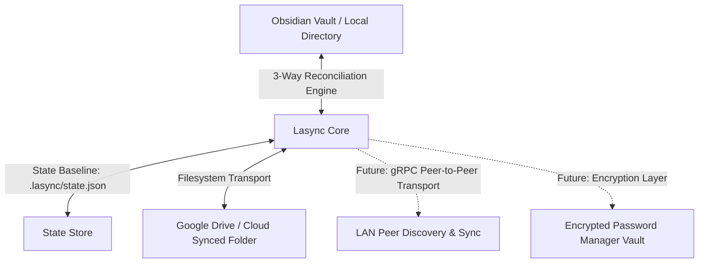

# Lasync (LAN & Cloud Sync Engine)

**Lasync** is an offline-first synchronization engine written in Rust, built to sync file trees (like Obsidian vaults) and vaults across devices over local networks (LAN) and cloud storage (e.g., Google Drive) without relying on proprietary cloud sync services.

---

## How It Works

### The Cloud/Drive Syncing Layer
In this first stage, Lasync implements the **Drive Syncing Method**:
1. **Drive is just the transport**: The Google Drive (or OneDrive/iCloud/Dropbox) desktop client syncs a folder on your filesystem. Google Drive is completely unaware of Lasync — to Drive, files are just being read or updated locally.
2. **Local Vault vs. Cloud Folder**: Lasync monitors both your active working directory (e.g. `~/Obsidian/Vault`) and the Drive-synced directory (e.g. `G:\My Drive\VaultSync`).
3. **3-Way Reconciliation**:
   - Compares **Local State**, **Remote (Drive) State**, and a persistent **Baseline State** (`.lasync/state.json`).
   - Distinguishes between new files created locally vs. files deleted on the remote device.
   - Detects concurrent edits made offline on multiple devices.
4. **Safe Conflict Handling**:
   - If a file is modified simultaneously on both sides, Lasync preserves both! It keeps the local version intact and generates a conflict file (`note.sync-conflict-<timestamp>.md`) synced to both devices.
5. **Atomic Writes**: Writes changes through temporary files before swapping, preventing partial reads by Obsidian or Google Drive during active syncs.

---

## CLI Usage

### 1. Initialize a Vault
Link your local vault to your Drive folder:
```bash
lasync init --local "C:\Users\<user>\Documents\ObsidianVault" --remote "G:\My Drive\VaultSync"
```
This saves `.lasync/config.json` inside your vault.

### 2. Check Status (Dry-Run)
Inspect pending additions, modifications, deletions, and conflicts without writing anything:
```bash
lasync status
```

### 3. Run a One-Time Sync
Perform a single reconciliation pass:
```bash
lasync sync
```

### 4. Continuous Live Watching
Run Lasync as a background daemon that watches for file changes in real-time, debounces rapid edits (e.g. while typing in Obsidian), and automatically syncs:
```bash
lasync watch --debounce-ms 1000
```

---

## Architecture & Roadmap



- **Phase 1 (Complete)**: Core sync engine, 3-way reconciliation, SHA-256 file tracking, atomic writes, conflict preservation, live file watcher.
- **Phase 2 (Upcoming)**: gRPC communication layer for direct LAN peer-to-peer sync between devices on the same Wi-Fi.
- **Phase 3 (Upcoming)**: End-to-end encryption layer (single vault file for password management and full vault encryption).
